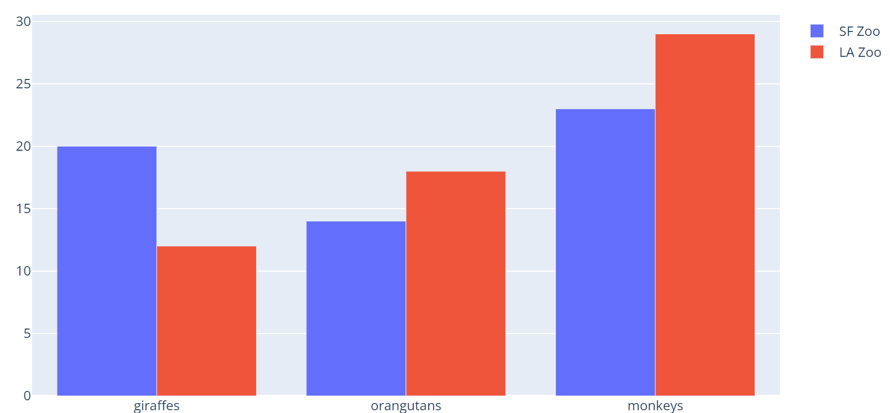
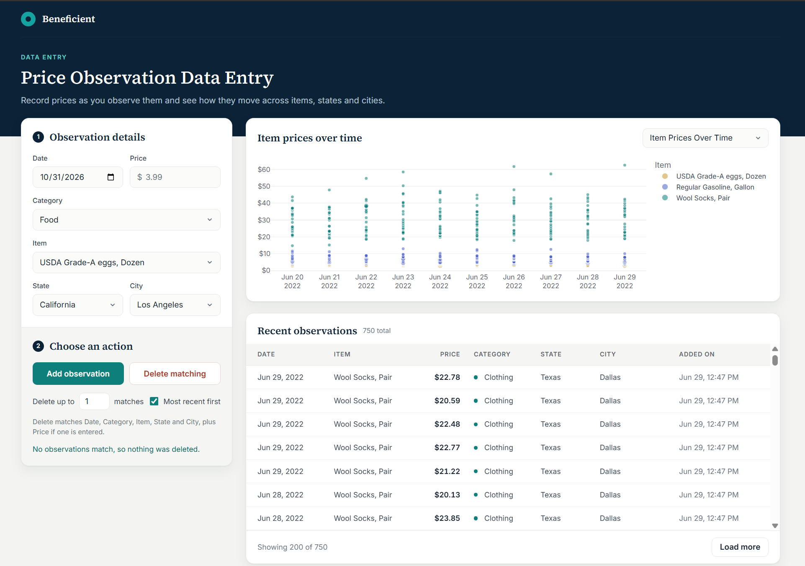

# Beneficient Risk Developer Coding Test

This repo contains a coding test for potential risk developers: a small app for entering price observations and charting them. It has two parts:

| Folder | What it is |
|---|---|
| `server/` | Flask REST API and the Python data logic. See `server/README.md`. |
| `client/` | Vue 3 front end (built with Vite) that calls the API. See `client/README.md`. |

You are encouraged to use AI-assisted development tools such as Claude Cowork/Code/Design, GitHub Copilot, OpenAI Codex, and others. However, **you are still expected to have a solid understanding of the architecture, underlying business and engineering requirements, issues and gaps you addressed, the code you submitted, and the reasoning behind your design and implementation decisions.**

If you used any AI-assisted development tools, **you must disclose them in the `Disclosures` section at the end of this file.** You must also include the relevant project configuration files in your submission so we can understand how you configured and used these tools. Examples include `CLAUDE.md` and the `.claude/` directory, or the equivalent files and directories for your tool (e.g., `AGENTS.md` or `.cursor/`). **Remove all API keys, access tokens, and other secrets from these files before submitting them.**

Feel free to add comments anywhere in the code.

## Quick start

Docker is optional. Option B runs the app with just Python and Node.js, so if you don't have Docker, skip Option A and start with Option B instead of installing it.

### Option A: Docker

Open the Docker Desktop app first and wait until it shows Docker is running. Then, from the project folder, run:

```bash
docker compose up --build
```

Open http://localhost:5173. Press `Ctrl+C` to stop. If Docker says it can't connect to the Docker daemon, Docker Desktop isn't running yet.

### Option B: Run each part yourself (no Docker needed)

You need Python 3.12, the same version the Docker setup uses, so the packages you freeze install the same way for us. You also need Node.js 22.12+. Open two terminals in the project folder.

**Terminal 1: server**

```bash
cd server
py -3.12 -m venv .venv          # Windows
python3.12 -m venv .venv        # macOS / Linux
.venv\Scripts\activate          # Windows
source .venv/bin/activate       # macOS / Linux
pip install -r requirements.txt
python app.py
```

Run `python --version` after activating to confirm it shows 3.12. If you use conda instead, run `conda create -n risk-dev-test python=3.12` and `conda activate risk-dev-test` in place of the venv lines.

**Terminal 2: client**

```bash
cd client
npm install
npm run dev
```

Open http://localhost:5173.

| | Address |
|---|---|
| App | http://localhost:5173 |
| API | http://localhost:5001/api/observations |

### If a port is already in use

The server uses port 5001 and the client uses 5173. If one is taken, stop the program that's using it, or move the app to another port:

- **Find what's using it:** on Windows, `netstat -ano | findstr :5001`, then end that process ID in Task Manager. On macOS or Linux, `lsof -i :5001`.
- **Server:** change `FLASK_RUN_PORT` in `server/.env`, and use the same port in `API_URL` in `client/.env`.
- **Client:** change `port: 5173` in `client/vite.config.js`.
- **Docker:** change the first number of the port in `compose.yaml`, e.g. `"5002:5001"`. Only the address on your machine changes.

## Project structure

```
risk-dev-test/
├── compose.yaml         Docker setup for both parts
├── server/              Flask REST API (Python)
│   ├── .env             server settings
│   ├── app.py           API routes and input validation
│   ├── cpi.py           Observation model and database access
│   ├── options.json     categories, items, states and cities for the drop-downs (editable)
│   ├── migrate.py       one-off clean-up of the existing rows
│   ├── test_*.py        unit tests (python -m unittest)
│   └── test.db          SQLite database with sample data
├── client/              Vue 3 front end (JavaScript)
│   ├── .env             client settings
│   ├── vite.config.js   dev server and /api forwarding
│   └── src/             App.vue, api.js, format.js, theme.js, components/, assets/, format.test.js (npm test)
├── backup_db/
│   └── test.db          the original database, as shared with the assignment (before migrate.py)
└── screenshots/         the Claude Design mock-up (design_sample.png) and the finished app (final_app.png)
```

## Adding categories, items, states and cities

The drop-down choices live in `server/options.json`, not in the code. Add an entry there, then refresh the page. For example, put `{ "name": "Whole Milk, Gallon", "sample_base_price": 3.49 }` in a category's `items`. The server checks the file when it starts and names any mistake. See `server/README.md` for details.

## Tasks

Complete these in any order. Keep data transformations (filtering, grouping, averaging) in the server; the client should fetch the results and display them.

1. When the **Save Observation** button is clicked, send the form values to the server through a new API endpoint, store them as a new row in the database, then update the table and the graph.
2. Complete the `Observation.delete_matching` method in `server/cpi.py`, which contains detailed instructions.
3. When the **Delete Matching Observations** button is clicked, call `Observation.delete_matching` through a new API endpoint, then update the database, the table and the graph.
4. When **Graph Type** is set to **Item Prices Over Time**, multiple observations of the same item with the same price should make the point size scale in proportion to the number of matching observations.
5. Implement the **Average Item Price by City** graph type: a grouped bar chart where each bar's height is the average price of an item in a city on the date in the **Date** field. Group the bars by item, and color each bar by the city it applies to:

   

6. `server/.env` and `client/.env` include settings the code doesn't use yet. Use `MAX_PRICE` so the API rejects prices above it, and `VITE_CURRENCY` to display prices as currency in the client.

## Bonus tasks

Add any enhancements that would make the code production quality, for example:

- Make the display (theme, layout, fonts, etc.) more polished and professional/commercial looking. You are encouge to use AI tools like Claude Design.
- Add data validations that make sense for the business logic
- Format data cleanly, in line with American business conventions
- Refactor existing code where it improves readability, extensibility or performance
- Add tests that verify the behavior of your changes
- Document the server and client in `server/README.md` and `client/README.md`: how to run them, the endpoints and components you added, and the decisions you made

List your enhancements in the **Enhancements** section below.

## Grading criteria

- Completion of the tasks and bonus tasks
- Maintainability and readability of the code
- Thoughtful comments and descriptive variable names
- Performance: no noticeable delay when changing graphs or deleting points
- A sensible split of work between the server and the client

## Submitting

Before you zip the project, record every package you used so we can install the same versions:

- **Python:** from `server/`, with the virtual environment active, run `pip freeze > requirements.txt`. If you used conda instead of a venv, run `pip list --format=freeze > requirements.txt`.
- **JavaScript:** add packages with `npm install --save-exact <package>`, which records the exact version in `client/package.json` and `client/package-lock.json`. To check, run `npm ls --depth=0` from `client/`: nothing should be marked `extraneous`.

Then list your enhancements in the **Enhancements** section below, zip the project folder without the `node_modules` and `.venv` folders, and email it to your recruiter, who will send it to us.

## Who do I talk to?

- recruiting@beneficient.com

## Enhancements



- **Design:** rebuilt from a Claude Design mock-up (`screenshots/design_sample.png`), charts included, and it works on phones.
- **Validation:** the server checks every field, reports all problems at once, and keeps Item and City consistent with Category and State.
- **Formatting:** prices in the `VITE_CURRENCY` currency, dates like "Jun 29, 2022", and times in the viewer's time zone.
- **Usability:** linked drop-downs, messages under each field, a confirmation before deleting, a shortcut to the latest date with data, and "Load more" in the table.
- **Safety:** parameterized SQL, guards against deleting everything by mistake, error messages that hide internal details, and a log of every delete.
- **Data clean-up:** `migrate.py` gave the existing rows one date format, prices rounded to the cent, and the correct spelling of Los Angeles.
- **Bugs fixed:** a blank Item drop-down, tests that wiped `test.db`, dates stored in two formats, a stale `AddedOn`, a typo warning that could never fire, and dates shown a day early in the Americas.
- **Tests:** 44 server tests and 8 client tests, several confirmed by deliberately breaking the code.

## Key decisions

- **The server owns the logic; the browser presents it.** Filtering, counting, averaging and grouping run in SQL on the server. The browser only formats and draws.
- **Options are data, not code.** Categories, items, states and cities come from `server/options.json`, so new ones can be added without touching the code. The file is checked at startup.
- **The server is the gatekeeper.** It validates every request, because the API can be called without the page.
- **Stored data has one shape.** Dates are stored as `YYYY-MM-DD` and prices in dollars, rounded to the cent. Queries always use parameters.
- **Deleting is predictable and safe.** It matches the form's fields, and the price only if one is typed. It removes the newest or oldest first, with ties broken by entry order. It refuses to run without a filter, and every delete is logged.
- **The charts are honest.** A dot's area is proportional to the number of observations it stands for, and the bar chart shows the date chosen in the form.
- **Display is the client's job.** The server sends plain numbers and dates. Currency, date style and time zone are applied in the browser.
- **The table scales.** It loads the newest 200 rows, and "Load more" fetches older ones only when asked. This keeps every reload fast: with 75,000 rows, it takes 58 ms instead of 687 ms.

## Notes for reviewers

- Tested with Docker. Run the tests with `docker compose exec server python -m unittest` and `docker compose exec client npm test`.
- `test.db` holds the original sample data, cleaned by `migrate.py`.
- Next steps I'd consider: warnings for unusual prices, and logins, so the delete log records who deleted.

## Disclosures

I used **Claude Code** to plan, build and test this project (its guidelines are in `CLAUDE.md`), and **Claude Design** to create the page design (`screenshots/design_sample.png`).
